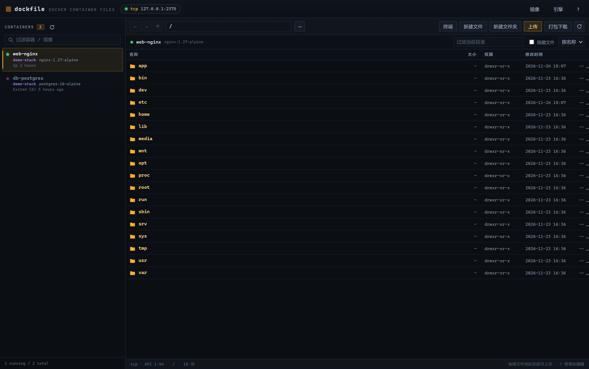
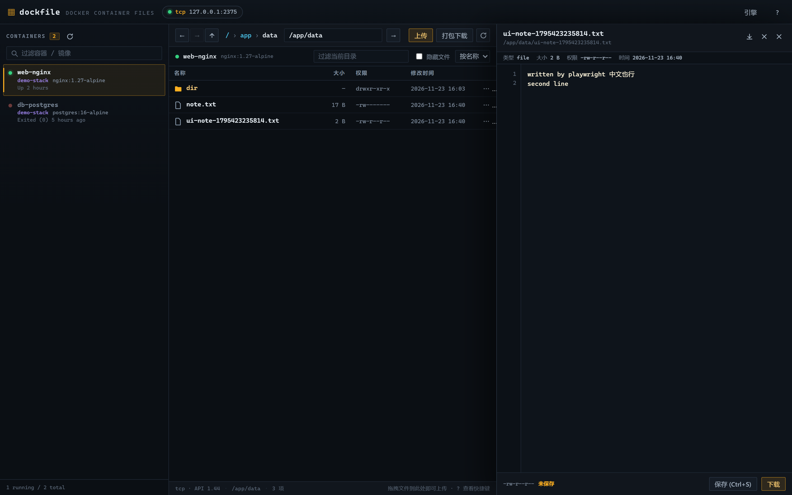
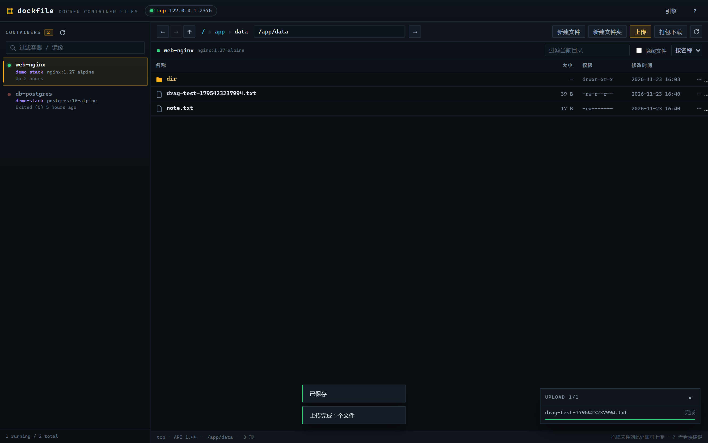
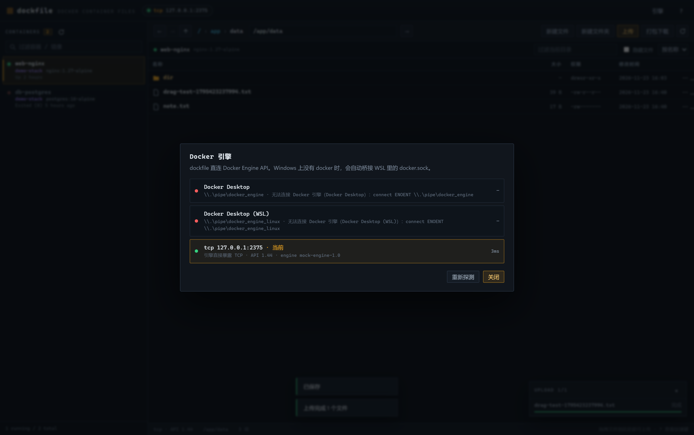
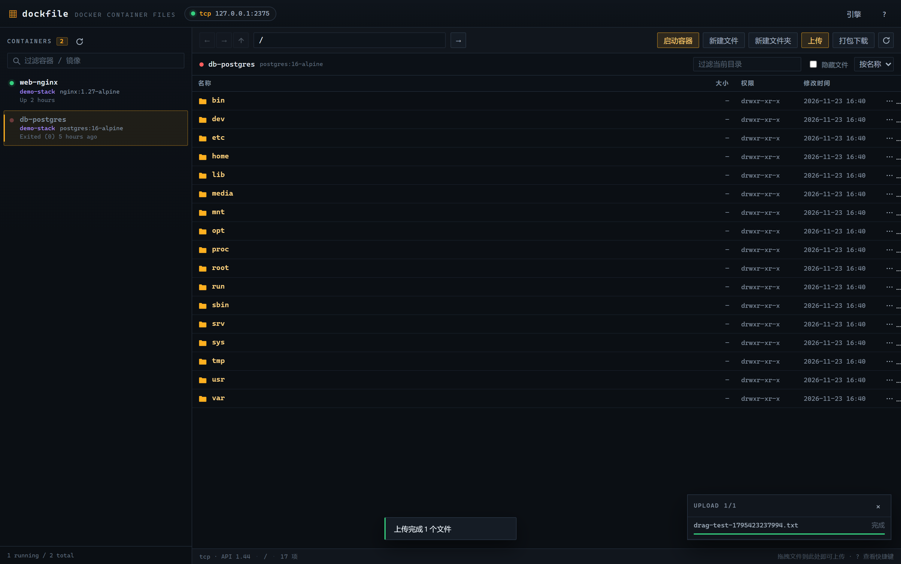
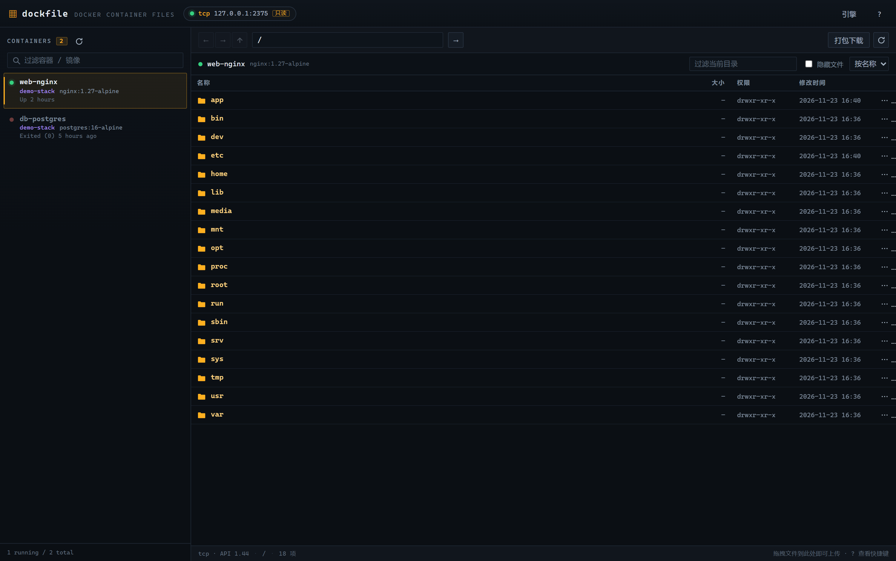
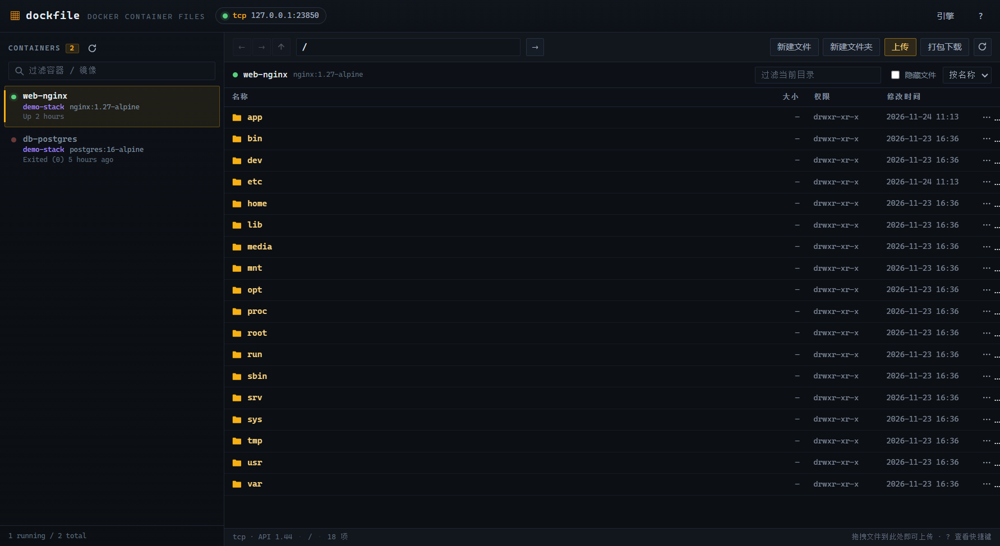

# dockfile · Docker 容器文件管理器

[](https://github.com/laohuan12138/docker-file-manage/actions/workflows/ci.yml)
[](LICENSE)
[](package.json)

在浏览器里直接浏览、上传、下载、编辑**任意容器内的文件**——包括**已停止的容器**和**没有 shell 的 distroless 镜像**。

直连 Docker Engine API（不依赖 `docker` CLI），Windows 上自动桥接 **WSL 里装的 Docker**，同时支持 Docker Desktop、Linux/macOS 本机 socket 和远程 `tcp://` 引擎。



---

## 为什么不用 `docker cp`

| 需求 | `docker cp` / `docker exec` | dockfile（Engine API） |
|---|---|---|
| Windows 上没有 `docker.exe`（Docker 装在 WSL 里） | 不可用 | ✅ 自动桥接 WSL 的 docker.sock |
| 已停止的容器 | `exec` 不可用 | ✅ 读、上传、建目录都能用 |
| distroless / 无 shell 镜像 | `exec` 不可用 | ✅ 走 archive 接口 |
| 拖拽上传 / 目录下载 / 进度条 | 需要自己拼命令 | ✅ 原生流式 |
| 中文文件名、符号链接、权限 | 解析 `ls` 输出 | ✅ 直接读 tar 头，信息完整 |

---

## 功能

**浏览**
- 容器列表：运行 / 已停止 / 暂停，镜像、compose 项目、状态；支持过滤与刷新
- 目录浏览：面包屑、可编辑路径框、前进 / 后退 / 上级、按名称/大小/时间/类型排序、隐藏文件开关、当前目录过滤
- 文件元数据：大小、POSIX 权限、修改时间、符号链接目标
- 大目录（上万条）自动截断并提示，根目录秒开（走 `exec stat` 快路径，不会把整棵子树打包下载）

**查看 / 编辑**
- 文本文件内联查看与编辑（≤2 MB），行号、`Ctrl+S` 保存、未保存提示
- 图片 / 视频 / 音频 / PDF 内联预览
- 二进制文件给出体积提示并提供下载

**上传 / 下载**
- **拖拽上传**：文件直接拖到列表任意位置即落到当前目录；**整个文件夹拖拽**会保留目录结构（空目录也会创建）
- 多文件并发上传（3 路），每个文件独立进度条、失败可见
- 同名文件覆盖确认；上传前自动 `mkdir -p` 补齐缺失的父目录
- 下载单文件（正确的中文文件名）、把当前目录打包成 `.tar.gz` 流式下载（不经过内存）

**写操作**
- 新建文件 / 新建文件夹 / 重命名 / 修改权限 / 多选删除（右键菜单或快捷键）
- 容器未运行时给出明确提示，并提供「启动容器」按钮

**引擎**
- 多候选端点自动探测 + 顶栏一键切换（Windows 管道 / 每个 WSL 发行版 / tcp / unix socket）
- WSL relay 断线自愈；重启后自动复用上次建立的 relay







---

## 快速开始

要求：Node.js ≥ 18（本机实测 v24）。**运行时零依赖，不需要 `npm install`。**

```bash
# Windows：双击 start.cmd，或
node server.js --open

# Linux / macOS
./start.sh            # 等价于 node server.js --open
```

默认地址 `http://127.0.0.1:7788`，启动时会在终端打印实际连上的引擎：

```
  dockfile  v1.0.0  ·  Docker 容器文件管理器
  本地地址   http://127.0.0.1:7788
  引擎       WSL · Ubuntu-22.04  ·  engine 27.5.1  ·  API 1.47  ·  16ms
```

> 下面截图都来自内置的 mock engine（`npm run mock`），容器名是合成的演示数据。

### 没有 Docker 也想看界面

```bash
npm run mock                                              # 起一个假引擎 + 示例容器
node server.js --docker-host tcp://127.0.0.1:23750 --open  # 另开一个终端
```

---

## 桌面版（Electron）

不想开终端就用桌面版：窗口里是同一套界面，内部服务跑在 `127.0.0.1` 的**随机空闲端口**上，只有本窗口能访问。



```bash
npm install            # 只在桌面开发/打包时需要（Electron 属于 devDependency，运行时依旧零依赖）
npm run desktop        # 开发模式直接开窗口
npm run dist           # 打包 → release/dockfile-<版本>-portable.exe + release/dockfile-<版本>-setup.exe
```

产物（`release/`）：

| 文件 | 说明 |
|---|---|
| `dockfile-<版本>-portable.exe` | 免安装，双击即用（约 71 MB，运行时自解压到临时目录） |
| `dockfile-<版本>-setup.exe` | 安装版：可选安装目录、桌面/开始菜单快捷方式、卸载项 |

桌面版比浏览器版多出来的东西：

- **单实例**：重复双击只会聚焦已有窗口，不会起第二个服务
- **托盘图标**：显示窗口 / 在浏览器打开 / 打开下载目录 / 退出
- 窗口大小与位置记忆；`Ctrl+R` 刷新、`F12` 开发者工具、`Alt+F4` 退出
- **下载**由主进程直接写盘（不走 Chromium 下载器）：默认保存到系统「下载」文件夹，重名自动加序号，页面弹出「已保存到 …」提示并弹系统通知，点击通知定位文件；想换目录就设 `DOCKFILE_DOWNLOAD_DIR`
- 关闭窗口即退出，并顺手清掉 WSL 里的 relay

> 未做代码签名：首次运行 Windows SmartScreen 会提示，点「更多信息 → 仍要运行」即可。
> 首次打包会下载 Electron 运行时，国内可加 `ELECTRON_MIRROR=https://npmmirror.com/mirrors/electron/`。

桌面版与命令行版共用 `lib/server-core.js`，所以 WSL 桥接、引擎切换、拖拽上传这些行为完全一致。

---

## 连接引擎

### 自动探测顺序

1. `DOCKER_HOST` 环境变量 / `--docker-host`
2. Windows：`\\.\pipe\docker_engine`、`\\.\pipe\docker_engine_linux`（Docker Desktop）
3. `tcp://127.0.0.1:2375`（引擎直接对外暴露）
4. **WSL 里的 Docker**：逐个发行版探测 `/var/run/docker.sock` + `docker version`
5. Linux/macOS：`/var/run/docker.sock`、`$XDG_RUNTIME_DIR/docker.sock`、`~/.docker/run/docker.sock`、`/run/podman/podman.sock`

顶栏「引擎」按钮会列出所有候选端点及其探测结果，可以直接切换。

### 手动指定

```bash
node server.js --docker-host unix:///var/run/docker.sock
node server.js --docker-host npipe:////./pipe/docker_engine
node server.js --docker-host tcp://192.168.1.10:2375

# 只连指定 WSL 发行版
node server.js --wsl-distro Ubuntu-22.04

# 传输方式：auto（默认）| relay（强制端口转发）| stdio（强制 dial-stdio）| socket（不碰 WSL）
node server.js --transport stdio
```

### WSL 桥接怎么工作

Windows 侧的 `dockfile` 拿不到 WSL 内的 unix socket，所以用两条通道：

| 通道 | 做法 | 说明 |
|---|---|---|
| `relay`（默认） | 把 `lib/wsl-relay.sh` 写进 WSL，用 `socat`（没有则用 `python3`）把 `docker.sock` 转发到 WSL 内的 `127.0.0.1:2376x`，Windows 通过 WSL2 的 localhost 转发访问 | 真 HTTP 连接，支持 keep-alive 并发、大文件流式 |
| `stdio`（回退） | `wsl.exe -d <发行版> -- docker system dial-stdio`，在子进程的 stdin/stdout 上手写 HTTP/1.1 | 不需要端口、不需要 socat/python3，localhost 转发被关时仍可用 |

细节：
- relay 只监听 `127.0.0.1`，端口在 `23760–23789` 里挑空闲的；启动时优先**复用**上次遗留的 relay，超过 10 分钟未被复用的才清理，避免端口堆积
- relay 被 WSL 重启清掉时，下一次请求会自动重建并重试一次，页面无感
- 退出（Ctrl+C）会停掉 relay

---

## 界面快捷键

| 按键 | 作用 |
|---|---|
| `↑` `↓` | 移动光标 |
| `Enter` | 打开目录 / 预览文件 |
| `Backspace` | 返回上级目录 |
| `Alt`+`←` / `Alt`+`→` | 后退 / 前进 |
| `Ctrl`+`L` | 聚焦路径输入框 |
| `Del` | 删除选中 |
| `F2` | 重命名选中 |
| `F5` | 刷新 |
| `Ctrl`+`S` | 保存正在编辑的文件 |
| `Esc` | 关闭抽屉 / 弹窗 |
| `?` | 快捷键帮助 |

右键任意行可打开菜单（预览 / 下载 / 重命名 / 权限 / 删除）。

---

## HTTP API

所有接口都在 `/api` 下；`--token` 时需带 `X-Auth: <token>` 或 `?token=<token>`；`--read-only` 时所有写接口返回 403。

| 方法 | 路径 | 说明 |
|---|---|---|
| GET | `/api/health` | 引擎状态、类型、API 版本、是否只读 |
| GET | `/api/endpoints` | 全部候选端点与探测结果（`?refresh=1` 重新探测） |
| POST | `/api/endpoints/select` | `{key}` 切换引擎 |
| GET | `/api/containers` | 容器列表 |
| POST | `/api/containers/:id/start` | 启动容器 |
| GET | `/api/containers/:id/ls?path=/` | 列目录（`kind=dir` 或 `kind=file`） |
| GET | `/api/containers/:id/stat?path=` | 单个路径元数据 |
| GET | `/api/containers/:id/text?path=` | 文本内容（≤2 MB，返回 `binary`/`truncated` 标记） |
| PUT | `/api/containers/:id/text?path=&mode=` | 保存文本（自动 `mkdir -p`） |
| GET | `/api/containers/:id/file?path=&name=` | 下载单文件（流式） |
| GET | `/api/containers/:id/raw?path=` | 内联返回（图片/视频/PDF 预览） |
| GET | `/api/containers/:id/download?path=&gzip=1` | 目录打包下载（流式） |
| POST | `/api/containers/:id/upload?path=&name=&dir=1` | 上传（body 即文件字节；`dir=1` 建空目录） |
| POST | `/api/containers/:id/mkdir?path=&mode=` | 新建目录 |
| POST | `/api/containers/:id/rename` | `{from,to}` |
| POST | `/api/containers/:id/chmod` | `{path,mode}` |
| POST | `/api/containers/:id/delete` | `{paths:[...]}` |

错误统一为 `{"error":{"code","message","hint"}}`，`message` 是中文原因，`hint` 是下一步建议（例如容器未运行时提示启动容器）。

---

## 测试

```bash
npm test          # tar 单元测试 + 对 mock engine 的接口全链路（不需要 Docker）
npm run test:live # 真实引擎只读断言 + 一次性 alpine 容器的写操作链路（自己清理）
npm run test:ui   # Playwright：目录浏览、预览、拖拽上传、下载、引擎弹窗 + 截图到 docs/
```

- `npm test`：33 项，覆盖 tar 读写 / PAX 长名 / 中文名 / 截断容错、目录列举、文本读写、3.4 MB 上传 sha256 校验、目录打包下载解包、429/403/401/400/404 各类错误、只读模式、token 鉴权
- `npm run test:live`：与 `docker ps -a`、`docker exec ls`、`docker exec cat` 逐条对拍；写操作在 `dockfile-selftest` 容器里进行，结束时删除测试目录
- `npm run test:ui`：真实引擎 + Chromium，产出 `docs/*.png`

Playwright 用的是本机已装的 Chromium（`~/AppData/Local/ms-playwright`），没有时 `npm i -D playwright-core` 即可。

---

## 故障排查

| 现象 | 原因 / 处理 |
|---|---|
| 页面提示「未连接 Docker 引擎」 | 点顶栏「引擎」看探测结果；WSL 里先执行 `wsl -d <发行版> -- docker ps` 确认可用 |
| WSL 列表里没有发行版 | `wsl -l -q` 没有输出？确认 WSL 已安装并至少启动过一次 |
| 日志提示「docker 无权限」 | 把用户加入 docker 组：`sudo usermod -aG docker $USER`，然后重启 WSL |
| relay 连不上（端口不通） | WSL2 的 localhost 转发被关（`%USERPROFILE%\.wslconfig` 里 `localhostForwarding=false`）；用 `--transport stdio`，或删掉该配置后 `wsl --shutdown` |
| 目录列表很慢 | 已停止容器只能走归档接口（会把子树打包），启动容器后可秒开；顶栏有「启动容器」按钮 |
| 删除/重命名报「容器未运行」 | 这两个操作需要在容器内执行 `rm`/`mv`：先启动容器 |
| 删除报「镜像可能不包含 rm」 | distroless 镜像没有 `rm`；下载后重建镜像即可 |
| 端口 7788 被占用 | `node server.js --port 7789` |

---

## 安全说明

> **dockfile 等价于 Docker socket 的权限，也就是宿主机 root。**

- 默认只监听 `127.0.0.1`；`--bind 0.0.0.0` 会把容器 root 文件权限暴露给同网段，启动时会打印红色警告
- 需要跨机访问时建议用 `--token` + SSH 端口转发，而不是直接暴露端口
- WSL relay 期间，`docker.sock` 会以未鉴权的 TCP 形式暴露在 **WSL 内部的回环地址** 上（仅本机进程可见）；退出 dockfile 时会关闭 relay
- `--read-only` 可彻底禁用写操作（服务端 403 + 界面隐藏入口）

---

## 目录结构

```
server.js              命令行入口（参数解析、终端输出、自动开浏览器）
lib/
  server-core.js       服务内核：静态资源 + API + 引擎管理（命令行版与桌面版共用）
  endpoint.js          引擎发现 / 多端点切换 / 断线自愈
  docker.js            Engine API 客户端（archive、exec、容器）
  transport.js         unix / npipe / tcp 传输 + dial-stdio 上的手写 HTTP/1.1
  wsl.js               WSL 探测、relay 建立/复用/清理、stdio 回退
  wsl-relay.sh|.py     WSL 内的 relay 控制脚本与 python 回退实现
  fsops.js             文件语义层（列举、读写、上传、打包下载、删除…）
  tar.js               零依赖 tar 读写（ustar / GNU longname / PAX）
  util.js              路径归一化、mime、权限、文件名编码
  routes.js            HTTP API
web/                   零构建前端（原生 ES module）
electron/              桌面版主进程 + preload（共用 server-core，无框架改动）
build/icon.ico         打包用图标（由 tools/make-icon.js 生成）
tools/mock-engine.js   最小 Docker Engine 实现 + 自动生成的示例容器
test/                  tar / API / 真实引擎 / UI 四套测试
```

## 已知限制

- 不做多用户与 ACL；不做 Docker TLS 双向认证（`https://` 端点未验证）
- 文本编辑上限 2 MB；超过请下载后用本地编辑器
- 文件名含换行符时列表解析可能不准确（`stat` 输出按行切分）
- 目录下载是 tar/tar.gz 打包流，不支持断点续传

## License

MIT


